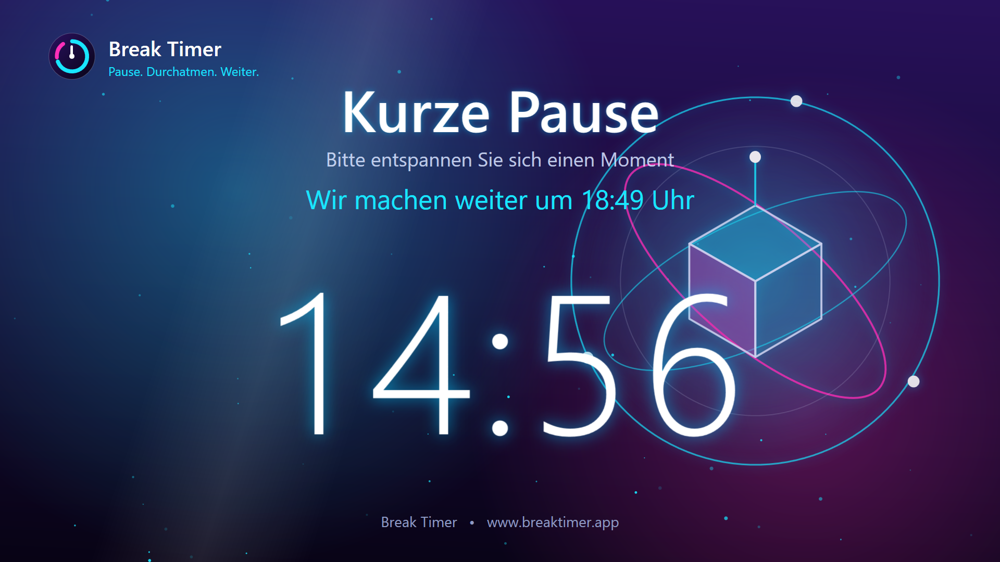
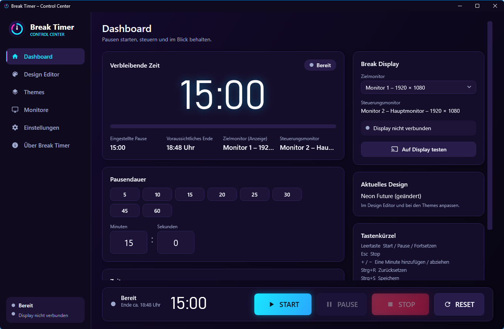
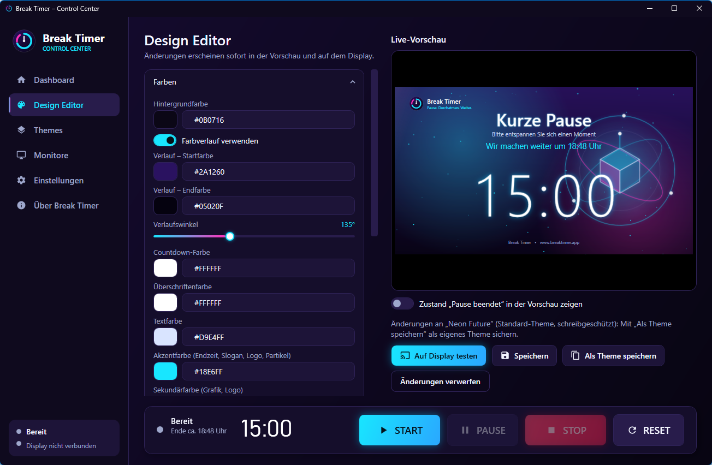

<div align="center">

# ⏱️ Break Timer

**Pausenanzeige für Schulungen, Seminare und Workshops**

Vollbild-Countdown auf dem Beamer – Steuerung bequem am eigenen Bildschirm.


</div>

<p align="center">
  
</p>

<p align="center">
  
  &nbsp;
  
</p>

<p align="center"><sub>Break Display (oben), Control Center mit Dashboard und Design Editor (unten)</sub></p>

---

## Was ist Break Timer?

Break Timer besteht aus zwei Teilen, die zusammen arbeiten:

* **Control Center** – die Steuerung für Trainer:innen auf dem Hauptmonitor: Dauer wählen, starten, pausieren, Zeit anpassen, Design bearbeiten.
* **Break Display** – die Anzeige für das Publikum: randlos im Vollbild auf dem gewählten Monitor (z. B. Beamer), mit großem Countdown, Endzeit („Wir machen weiter um 11:15 Uhr“), Branding und Grafik. Ganz ohne Bedienelemente.

Beide lesen denselben Zustand eines einzigen, stopwatch-basierten Timers – Anzeige, Vorschau und Steuerung laufen nie auseinander.

## Funktionen

| | |
|---|---|
| ⏲️ **Timer** | Schnellwahl 5–60 min oder freie Eingabe, Start · Pause · Fortsetzen · Stop · Reset, Zeit live anpassen (−5 … +10 min oder eigene Minuten), Endzeit passt sich automatisch an |
| 🖥️ **Mehrere Monitore** | Erkennung, Auswahl von Anzeige- und Steuerungsmonitor, negative Koordinaten, gemischte DPI, Monitor wird während der Pause abgesteckt → Anzeige wandert auf einen Ersatzmonitor und zurück |
| 🪟 **Ein Monitor** | Anzeige erscheint auf demselben Bildschirm, eine kleine Mini-Steuerung (Pause, ±1, Stop) bleibt sichtbar; `Esc` beendet die Pause |
| 🎨 **Design Editor** | Farben, Verlauf, Texte, Schriften, Layout, Hintergrundbild, Logo, Effekte – mit **Live-Vorschau** und „Auf Display testen“ |
| 🧩 **Themes** | 5 schreibgeschützte Standard-Themes (Neon Future, Minimal Dark, Neon City, Nature Break, Corporate), eigene Themes speichern, duplizieren, umbenennen, löschen, Import/Export (`.btheme` inkl. Bilder, oder `.json`) |
| ✨ **Animationen** | Bewegter Hintergrund, Lichtschweif, Partikel, rotierende Grafik (Geschwindigkeit einstellbar), Übergänge – alle optional, mit Hauptschalter |
| 🎞️ **Lottie-Animationen** | Eigene `.json`-Lottie-Dateien (z. B. aus After Effects / LottieFiles) als Ebene hinter oder vor dem Inhalt, per SkiaSharp/Skottie |
| 🔔 **Signalton** | Chime, Bell, Gong, Beeps oder eigene Audiodatei, Lautstärke, Test-Knopf |
| 💾 **Robuste Speicherung** | JSON in `%AppData%`, atomares Schreiben, Sicherung, beschädigte Dateien werden aussortiert statt Absturz; Import/Export/Standardwerte |

## Installation

1. Das aktuelle Release als ZIP herunterladen und entpacken.
2. `BreakTimer.exe` starten – fertig. Es ist keine Installation nötig, nur eine Instanz läuft gleichzeitig.

Voraussetzung: Windows 10 oder 11 (.NET Framework 4.8 ist enthalten).

## Selbst bauen

Voraussetzung: Visual Studio 2022 oder neuer (Workload „.NET-Desktopentwicklung“) **oder** das .NET SDK. C# 10.

```powershell
dotnet build BreakTimer.sln -c Release   # oder BreakTimer.sln in Visual Studio öffnen
.\build-release.ps1                       # Release nach dist\BreakTimer (+ dist\BreakTimer.zip)
dotnet test tests\BreakTimer.Tests        # 30 Tests
```

## Bedienung in 60 Sekunden

1. **Dashboard** öffnen, Pausendauer wählen und den **Zielmonitor** festlegen.
2. **START** drücken – das Break Display öffnet sich im Vollbild auf dem Zielmonitor.
3. Zeit bei Bedarf mit **±1 / ±5 / +10 min** anpassen; die Anzeige folgt sofort.
4. Im **Design Editor** Farben, Texte und Logo an dein Branding anpassen und als eigenes Theme speichern.
5. **STOP** (oder `Esc`) beendet Pause und Anzeige.

### Tastenkürzel

| Taste | Aktion |
|---|---|
| `Leertaste` | Start / Pause / Fortsetzen |
| `Esc` | Stop – beendet Pause und Display (auch im Display und in der Mini-Steuerung) |
| `+` / `−` | ±1 Minute |
| `Strg` + `R` | Timer zurücksetzen |
| `Strg` + `S` | Einstellungen speichern |
| `Strg` + `Alt` + `B` | **Global**: Mini-Steuerung bzw. Control Center in den Vordergrund holen |

Außer `Strg+Alt+B` wirken die Kürzel nur, wenn das Control Center aktiv ist und kein Textfeld den Fokus hat.

## Lottie-Animationen

Im Design Editor unter **Lottie-Animation** eine `.json`-Datei importieren. Einstellbar: Ebene (hinter/vor dem Inhalt), Anpassung, Größe, Deckkraft, Position, Geschwindigkeit und Endlosschleife. Die Datei wird in den App-Ordner kopiert und mit dem Theme gespeichert – auch beim `.btheme`-Export. Ein Beispiel liegt unter [`samples/lottie-demo.json`](samples/lottie-demo.json).

> Skottie zeichnet nicht jedes After-Effects-Feature (z. B. Expressions). Bei Darstellungsfehlern hilft ein vereinfachter Export. Ist der Animations-Hauptschalter aus, zeigt das Display ein Standbild.

## Projektstruktur

| Projekt | Inhalt |
|---|---|
| [`src/BreakTimer.Core`](src/BreakTimer.Core) | Modelle (`Theme`, `AppSettings`), `TimerService`, `MonitorService`, `SettingsService`, `ThemeService`, `DesignState`, Audio-Synthese – **ohne WPF-Abhängigkeit** |
| [`src/BreakTimer.App`](src/BreakTimer.App) | WPF: Views, ViewModels, `DisplayWindowManager`, `SessionController`, Styles, Ressourcen |
| [`tests/BreakTimer.Tests`](tests/BreakTimer.Tests) | MSTest: Timer, Monitore, Speicherung, Themes, Import/Export |

**Architektur in Kürze**

* MVVM: Views enthalten nur Darstellungslogik, Befehle liegen in den ViewModels.
* `TimerService` mit injizierbarer Uhr (testbar), Zustandsautomat *Bereit / Läuft / Pausiert / Beendet / Gestoppt*.
* Das Display-Fenster wird per `WM_WINDOWPOSCHANGING`-Hook auf die echten Monitor-Pixelgrenzen fixiert (Per-Monitor-DPI v2). Der Inhalt liegt auf einer 16:9-Zeichenfläche und skaliert von 1366×768 bis 4K.
* `DesignState` hält das gemeinsame *Working*-Theme für Editor, Vorschau und Display; Standard-Themes werden nie überschrieben.
* Globale Fehlerbehandlung: Ausnahmen werden geloggt und als Hinweis angezeigt, die App bleibt bedienbar.

## Datenspeicherung

Alles liegt unter `%AppData%\BreakTimer\`:

* `settings.json` (+ `.bak`; beschädigte Dateien landen als `.corrupt-…` daneben)
* `themes\` – eigene Themes
* `resources\` – importierte Bilder, Logos und Lottie-Dateien (Kopien, unabhängig vom Originalpfad)
* `breaktimer.log`

## Bekannte Grenzen

* Mehrmonitor- und DPI-Verhalten wurde mit zwei 1080p-Monitoren manuell geprüft. Drei Monitore und gemischte DPI sind per Unit-Test mit simulierten Monitoren abgesichert.
* Eigene Audiodateien laufen über den Windows-MediaPlayer (WAV/MP3/WMA).
* Lottie: siehe Hinweis oben; sehr aufwendige Animationen belasten schwache Rechner stärker.

## Abhängigkeiten

Alles außer der Lottie-Wiedergabe ist im .NET Framework enthalten (JSON über `JavaScriptSerializer`). Mit der App werden folgende Komponenten von Drittanbietern ausgeliefert:

| Komponente | Version | Lizenz | Zweck |
|---|---|---|---|
| [SkiaSharp](https://github.com/mono/SkiaSharp) | 2.88.6 | [MIT](https://github.com/mono/SkiaSharp/blob/main/LICENSE.md) | Zeichnen der Lottie-Animationen |
| SkiaSharp.Skottie | 2.88.6 | [MIT](https://github.com/mono/SkiaSharp/blob/main/LICENSE.md) | Lottie-Wiedergabe (Skottie) |
| [Skia](https://skia.org/) (nativ, in `libSkiaSharp.dll`) | – | [BSD 3-Clause](https://github.com/google/skia/blob/main/LICENSE) | Grafikbibliothek von Google |
| [System.Memory, System.Buffers, System.Numerics.Vectors, System.Runtime.CompilerServices.Unsafe](https://github.com/dotnet/runtime) | – | [MIT](https://github.com/dotnet/runtime/blob/main/LICENSE.TXT) | Hilfsbibliotheken von Microsoft |

Dieselbe Übersicht steht in der App unter **Über Break Timer**.

## Autor

Entwickelt von **Petre Hoffmann** · © 2026 Petre Hoffmann

## Lizenz

Veröffentlicht unter der [Apache License 2.0](LICENSE).
